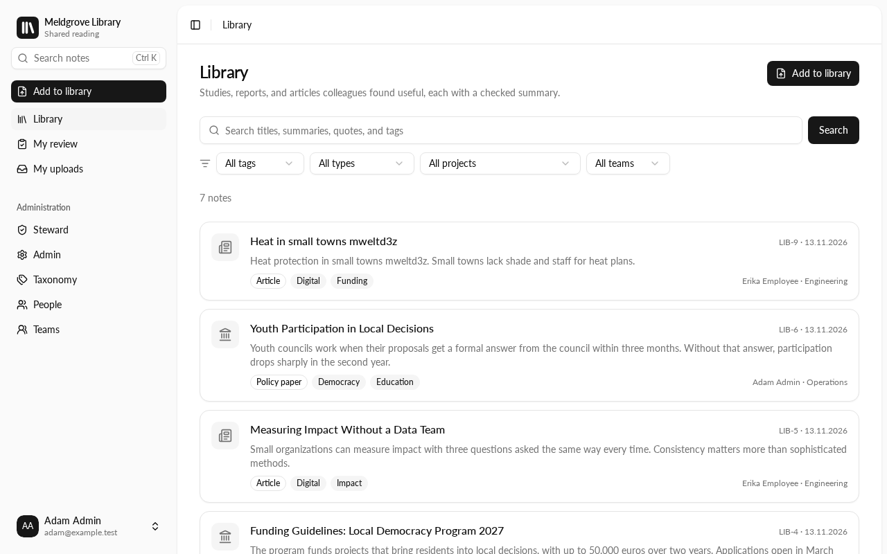
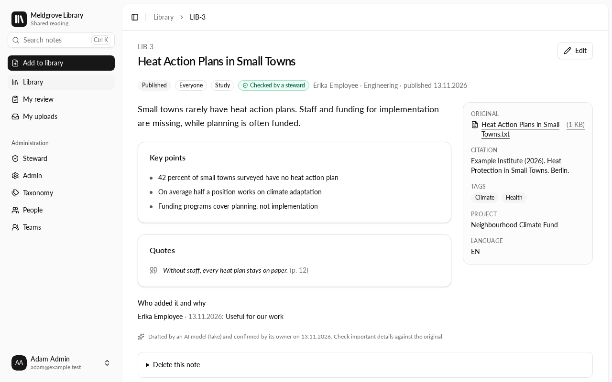
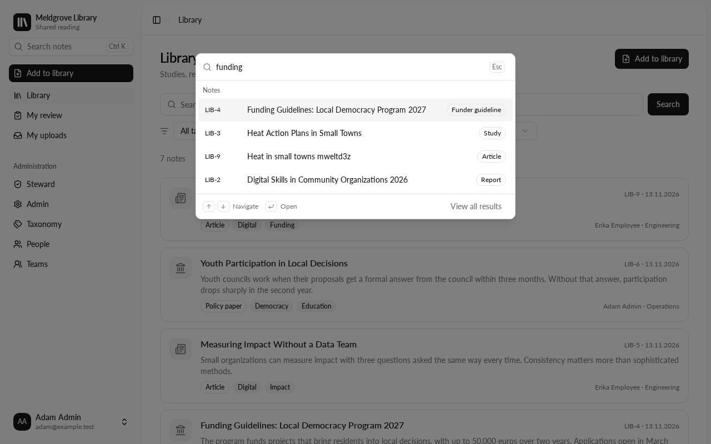

# Meldgrove Library

Meldgrove Library is a self-hosted shared library of external reading for
nonprofits and other organizations: studies, reports, articles, and funder
material. People add a file or a link, an AI model drafts a structured
source note, and the person who added it checks and publishes it. The
library is the place where everyone finds what colleagues have read, and
why.

- **One inbox for everyone**: upload in the browser, send a link or a file
  to a Slack bot, or forward it to an intake mailbox. Every source records
  who added it and why.
- **AI drafts, people decide**: the model fills a fixed note template (core
  statement, key points, quotes with page numbers, citation) and picks tags,
  document types, and projects from closed lists. Quotes not found in the
  source are dropped. Nothing is published before its uploader confirms it.
- **Any OpenAI-compatible AI provider**: Mistral, OpenAI, Azure OpenAI, or a
  self-hosted model, with a daily limit.
- **Untrusted uploads stay contained**: a screen holds back uploads with
  credentials, prohibited personal data, or hidden instructions for AI
  models; the model gets no tools.
- **Originals are kept** once per file, on a volume or in S3-compatible
  storage, for re-drafting and for checking quotes. Scanned PDFs get OCR.
- **Visibility per note**: "Everyone", "My team", or "Only me". Stewards
  check published notes and decide on uploads on hold.
- **Login with any OpenID Connect provider** (Keycloak, Microsoft Entra ID,
  Google, Okta, Authentik, Zitadel, …). People and teams are managed in the
  library (invitations), or synced from Keycloak groups.
- **Notifications and digests** by email (SMTP or MailerSend) or Slack,
  including weekly digests of new notes for everyone, for teams, and for
  people who follow tags.
- **Webhook**: published notes are posted as signed JSON, for example to a
  search index, a knowledge base, or an AI assistant.

## Screenshots

| Library | Note | Search (⌘K) |
|---|---|---|
|  |  |  |

The screenshots show example data from `npm run dev:seed`.

## Quick start (development)

Requirements: Node.js 26, npm, and Docker.

```sh
docker compose -f compose.dev.yaml up -d   # PostgreSQL 18, Keycloak with test users, S3, Mailpit
cp .env.example .env.local
npm ci
npm run db:migrate
npm run directory:sync                     # reads the test users from Keycloak
npm run dev:seed                           # optional: example notes
npm run dev                                # http://localhost:3000
npm run worker                             # in a second terminal: drafts uploads with a fake AI model
```

Sign in as `erika` (has access), `adam` (admin), or `olga` (no access), each
with the password `library-dev`. The development setup reads people and teams
from Keycloak groups; see [`.env.example`](.env.example) to try the manual
directory instead.

`compose.yaml` is the production setup, so a plain `docker compose up` runs
the library itself; see [Deployment](docs/deployment.md).

## Documentation

- [Architecture](docs/architecture.md): the way of an upload, data, review,
  untrusted content
- [Configuration](docs/configuration.md): every environment variable
- [Deployment](docs/deployment.md): Docker Compose, storage, health checks,
  upgrades, and automatic updates
- [Identity and access](docs/identity-and-access.md): OpenID Connect, the
  manual directory, the Keycloak directory, and who sees a note
- [Taxonomy and the replay test](docs/taxonomy.md)
- [Webhook](docs/webhooks.md): payload and signature
- [Contributing](CONTRIBUTING.md) and [security](SECURITY.md)

## Stack

Next.js 16 (App Router, Server Actions), TypeScript, PostgreSQL 18 with
Drizzle ORM, Better Auth, pg-boss, Tailwind CSS with shadcn/ui, Vitest, and
Playwright.
